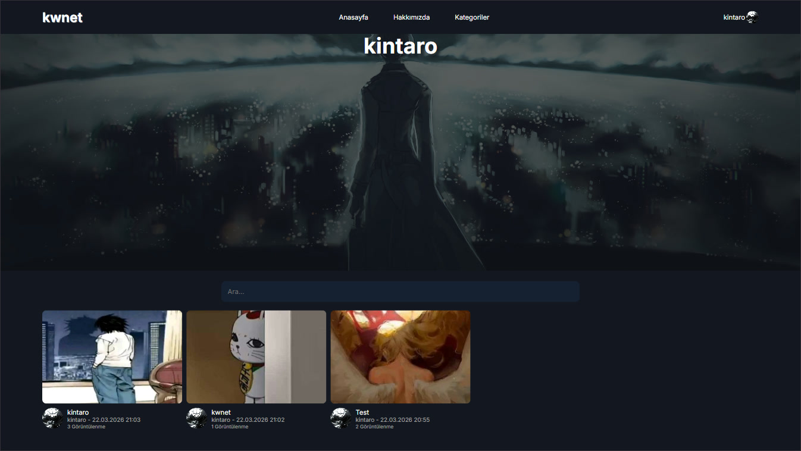
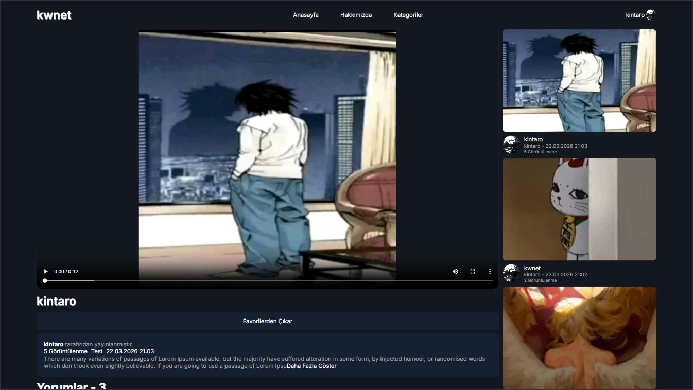
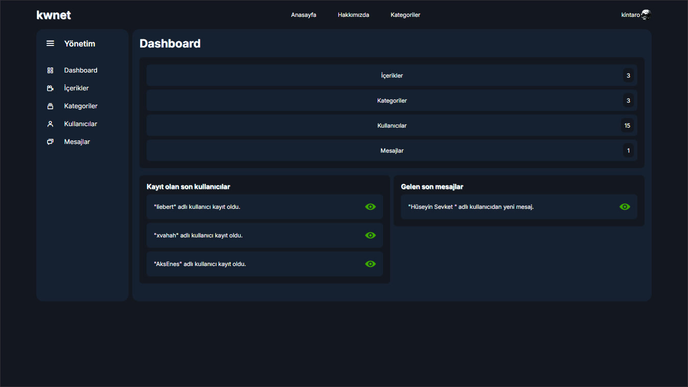
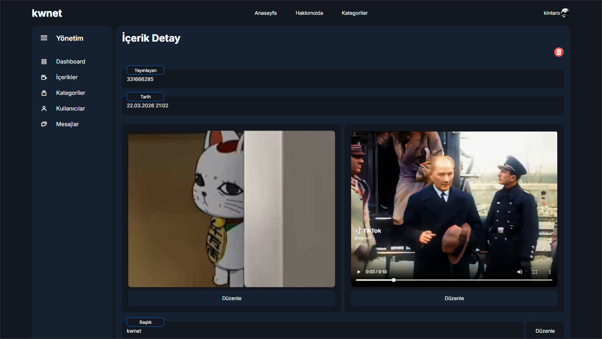
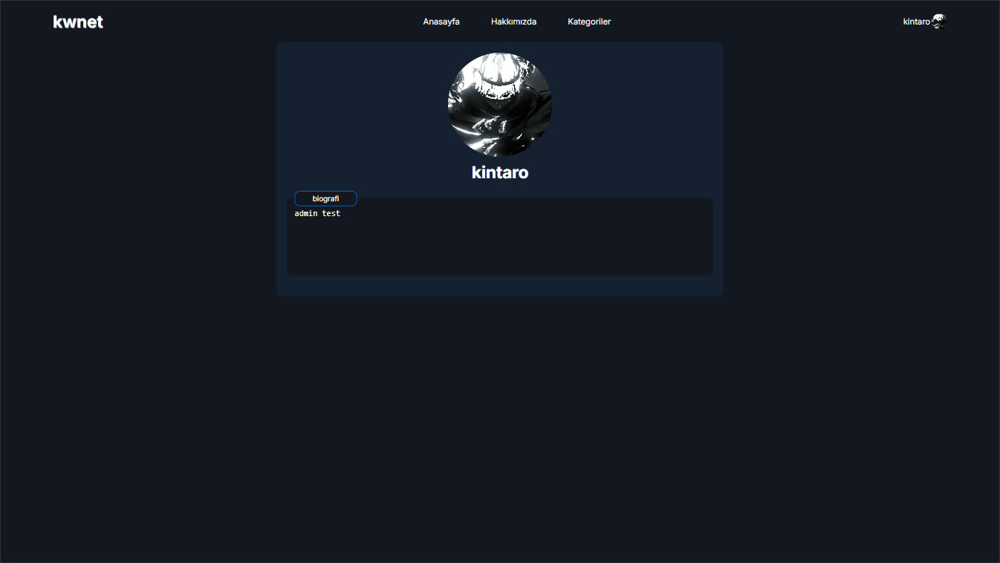

<a href="README.md">
  
</a>
<a href="README-TR.md">
  
</a>

  <br />
  <br />

<div align="center">
  
  <br />
  <br />

  <p>
     Okul projesi için ASP.NET ve MySQL ile hazırlanmış bir film sitesi.
  </p>


  <p>
    <a href="#info">Bilgilendirme</a> •
    <a href="#about">Hakkında</a> •
    <a href="#features">Özellikler</a> •
    <a href="#tech">Teknolojiler</a> •
    <a href="#setup">Kurulum</a> •
    <a href="#gallery">Galeri</a> •
    <a href="#license">Lisans</a>
  </p>

  <br />
  <br />
</div>

## <a id="info"></a> 📌 Bilgilendirme

Projedeki örnek görseller ve videolar sahiplerine aittir. Yalnızca bu okul projesinde örnek içerik olarak kullanılmıştır.

## <a id="about"></a> 📋 Hakkında

**kwnet**, web programlama ve veritabanı derslerinde öğrendiklerimi uygulamak için okul projesi olarak hazırladığım bir film sitesidir. Filmleri yöneticiler yükleyip yayınlar, kullanıcılar ise bu filmleri izleyebilir, yorum yazabilir ve favorilerine ekleyebilir. Proje, ASP.NET Web Forms ile sunucu taraflı geliştirme, MySQL ile veritabanı tasarımı, oturum yönetimi, CRUD işlemleri ve dosya yükleme konularını kapsar. Arayüz Türkçedir.

## <a id="features"></a> ✨ Özellikler

- **Kayıt ve giriş**: Adım adım ilerleyen bir formla kayıt olun, kullanıcı adınız ve şifrenizle giriş yapın.
- **Profiller**: Kendi profilinizi ve diğer kullanıcıların profillerini görüntüleyin, kullanıcı adınızı, şifrenizi, profil fotoğrafınızı ve biyografinizi değiştirin.
- **Film sayfaları**: Filmi video oynatıcıda izleyin, açıklamasını, görüntülenme sayısını, yayınlayan kişiyi ve yorumları görün.
- **Arama**: Ana sayfada filmleri adına göre arayın.
- **Daha fazla göster**: Bir butonla daha fazla film ve yorum gösterin.
- **Diğer filmler**: Film sayfası, yan panelde diğer filmleri listeler.
- **Yorumlar**: Filmlere yorum yazın, kendi yorumlarınızı düzenleyin ya da silin.
- **Favoriler**: Filmleri favorilerinize ekleyin ve favorilerim sayfasında görün.
- **Kategoriler**: Kategorilere göz atın ve bir kategorideki filmleri listeleyin.
- **İletişim formu**: Hakkımızda sayfasından mesaj gönderin.
- **Yönetim paneli**: Yöneticiler dört adımda film ekleyebilir, filmlerin başlığını, kategorisini, açıklamasını, kapağını ve videosunu düzenleyebilir, filmleri silebilir, kategorileri yönetebilir, kullanıcıları görebilir ve mesajları okuyup silebilir.

## <a id="tech"></a> 🛠️ Teknolojiler

`ASP.NET Web Forms` · `C#` · `.NET Framework 4.8` · `MySQL` · `MySql.Data` · `ImageResizer` · `HTML` · `CSS` · `JavaScript`

## <a id="setup"></a> 🚀 Kurulum

### Gereksinimler

- **Visual Studio**: [https://visualstudio.microsoft.com/](https://visualstudio.microsoft.com/)
- **.NET Framework 4.8**: [https://dotnet.microsoft.com/download/dotnet-framework/net48](https://dotnet.microsoft.com/download/dotnet-framework/net48)
- **XAMPP** veya başka bir MySQL sunucusu: [https://www.apachefriends.org/](https://www.apachefriends.org/)

### Adım Adım Kurulum

1. **Depoyu klonlayın**

   ```bash
   git clone https://github.com/xkintaro/asp.net-mysql-website.git
   cd asp.net-mysql-website
   ```

2. **Veritabanını oluşturun**

   - XAMPP kontrol panelinden **Apache** ve **MySQL** servislerini başlatın.
   - [http://localhost/phpmyadmin](http://localhost/phpmyadmin) adresini açın ve `kwnet` adında yeni bir veritabanı oluşturun.
   - Veritabanını seçin, **İçe Aktar** sekmesini açın ve `kwnet.sql` dosyasını içe aktarın.

3. **Bağlantı ayarlarını kontrol edin**

   Ortamınız farklıysa `site/Web.config` dosyasındaki bağlantı dizesini güncelleyin:

   ```xml
   <connectionStrings>
       <add name="MyDbConnection"
            connectionString="Server=localhost;Database=kwnet;User Id=root;Password=;"
            providerName="MySql.Data.MySqlClient" />
   </connectionStrings>
   ```

   XAMPP'te MySQL root kullanıcısının varsayılan olarak şifresi yoktur.

4. **Projeyi Visual Studio'da açın**

   - **File → Open → Web Site** yolunu izleyin ve `site/` klasörünü seçin.
   - Projeyi **Ctrl + F5** ile çalıştırın.

Siteyi `http://localhost:{port}/Default.aspx`, yönetim panelini ise `http://localhost:{port}/admin/` adresinde açın.

### Varsayılan Yöneticiler

- **Kullanıcı adı**: `admin` · **Şifre**: `12345678`
- **Kullanıcı adı**: `kintaro` · **Şifre**: `12345678`

## <a id="gallery"></a> 🖼️ Galeri













## <a id="license"></a> 📄 Lisans

Bu proje MIT Lisansı altında lisanslanmıştır. Detaylar için [LICENSE](LICENSE) dosyasına bakabilirsiniz.

#

<p align="center">
  <sub>❤️ Developed by "Mustafa TAŞAL" (kintaro)</sub>
</p>
