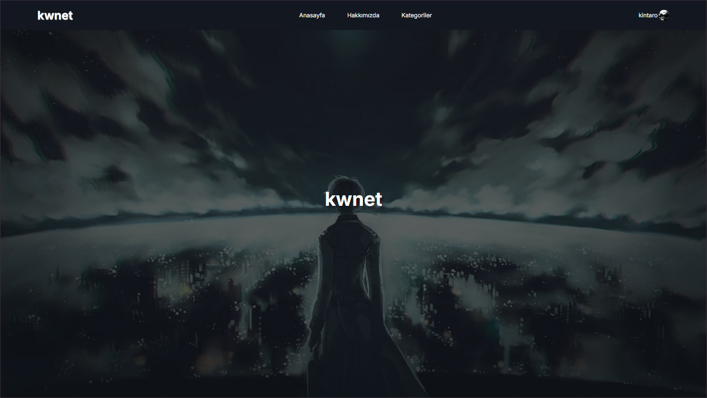
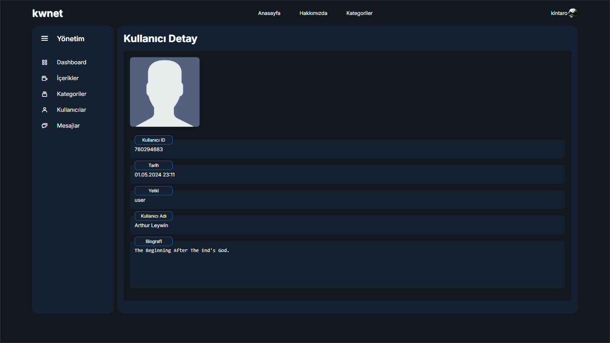

<a href="README.md">
  
</a>
<a href="README-TR.md">
  
</a>

  <br />
  <br />

<div align="center">
  
  <br />
  <br />

  <p>
    Okul projesi için kapsamlı film sitesi
  </p>
 


  <p>
    <a href="#features">Özellikler</a> •
    <a href="#tech">Teknolojiler</a> •
    <a href="#installation">Kurulum</a> •
    <a href="#license">Lisans</a> •
    <a href="#gallery">Galeri</a>
  </p>

  <br />
  <br />
</div>

## 📋 Hakkında

**kwnet**, filmlerin admin tarafından yüklenip yayınlandığı, kullanıcıların ise bu filmleri keşfedip izleyebildiği, yorum bırakabildiği ve favorilerine ekleyebildiği kapsamlı bir film izleme platformudur.

Proje; kullanıcı tarafı ve yönetim paneli olmak üzere iki ana bölümden oluşmaktadır. Kullanıcılar siteye kayıt olarak filmleri izleyebilir, yorum yapabilir ve favorilerine ekleyebilir. Film ekleme, düzenleme ve silme gibi içerik yönetimi işlemleri **yalnızca admin yetkisine sahip kullanıcılar** tarafından yönetim paneli üzerinden gerçekleştirilmektedir.

## 🎓 Okul Projesi

Bu proje, web programlama ve veritabanı yönetimi derslerinde edinilen bilgilerin pratiğe dökülmesi amacıyla geliştirilmiştir. ASP.NET Web Forms teknolojisi ile sunucu taraflı web geliştirme, MySQL ile ilişkisel veritabanı tasarımı, kullanıcı oturum yönetimi, CRUD işlemleri ve dosya yükleme gibi temel web geliştirme konularının uygulamalı olarak öğrenilmesini hedeflemektedir.

Akademik bir çalışma olması nedeniyle, projenin bazı alanlarında (güvenlik, performans optimizasyonu vb.) iyileştirme yapılabilir. Ancak proje; bir web uygulamasının baştan sona geliştirilmesi sürecini, veritabanı tasarımını, kullanıcı arayüzü oluşturmayı ve yönetim paneli geliştirmeyi kapsayan bütünleşik bir öğrenme deneyimi sunmaktadır.

## ✨ Özellikler <a id="features"></a>

### 👤 Kullanıcı Yönetimi

- **Kayıt Olma**: Çok adımlı kayıt formu
- **Giriş Yapma**: Kullanıcı adı ve şifre ile oturum açma
- **Çıkış Yapma**: Onay dialogu ile güvenli çıkış
- **Profil Görüntüleme**: Kendi profilini ve diğer kullanıcıların profilini görüntüleme
- **Profil Düzenleme**: Kullanıcı adı, şifre ve profil resmi güncelleme

### 🎥 Film İzleme

- **Film Detay Sayfası**: Video oynatıcı, kapak resmi, açıklama, görüntülenme sayısı, yayıncı bilgisi, yorumlar
- **Film Arama**: Anasayfada anlık film arama özelliği
- **Görüntülenme Sayacı**:
Her film için otomatik görüntülenme takibi
- **Daha Fazla Göster**: Sayfalama ile daha fazla film yükleme
- **Öneri Sistemi**: Film detay sayfasında yan panelde diğer filmler

### 💬 Etkileşim Sistemi

- **Yorum Yazma**: Oturum açmış kullanıcılar için filmlere yorum yazabilme
- **Yorum Düzenleme**: Kendi yorumlarını düzenleme
- **Yorum Silme**: Onay dialogu ile yorum silme
- **Favorilere Ekleme**: Filmleri favorilere ekleme ve çıkarma
- **Favorilerim Sayfası**: Favori filmlerin listelendiği kişisel sayfa

### 🗂️ Kategori Sistemi

- **Kategori Listeleme**: Tüm film kategorilerinin görüntülenmesi
- **Kategori Detay**: Seçilen kategoriye ait filmlerin filtrelenmesi
- **Kategori Yönetimi**: Admin panelinden kategori ekleme/silme/güncelleme

### 🛡️ Yönetim Paneli

- **Dashboard**: Yönetim paneli ana sayfa
- **Film Yönetimi**: Tüm filmleri listeleme, detay görüntüleme, başlık/açıklama/kategori/resim/video güncelleme
- **Film Ekleme**: 4 adımlı film ekleme sihirbazı (başlık → kategori → açıklama → kapak resmi & video dosyası)
- **Kullanıcı Yönetimi**: Tüm kullanıcıları listeleme ve detay görüntüleme
- **Kategori Yönetimi**: Film kategorilerini listeleme, ekleme, düzenleme ve silme
- **Mesaj Yönetimi**: İletişim formundan gelen mesajları listeleme, detay görüntüleme ve silme
- **Rol Kontrolü**: Yalnızca "admin" rolüne sahip kullanıcıların erişimi

### 🎨 Arayüz & Tasarım

- **Özel CSS Framework**: Kendi geliştirdiğim özel "kintaroCSS" kütüphanesi
- **Responsive Tasarım**: Media query'ler ile kusursuz şekilde her cihaz için uyumlu arayüz

## <a id="tech"></a>🛠️ Teknolojiler

### Backend

- **ASP.NET 4.8**: Sunucu taraflı web framework
- **C#**: Backend programlama dili
- **MySQL**: İlişkisel veritabanı yönetim sistemi

### Frontend

- **HTML5**: Sayfa yapısı ve semantik işaretleme
- **CSS3**: Stil ve görsel tasarım
- **JavaScript**: İstemci taraflı etkileşimler

### Araçlar

- **IIS / IIS Express**: Web sunucusu
- **phpMyAdmin**: Veritabanı yönetimi
- **XAMPP**: Yerel geliştirme ortamı (Apache + MariaDB)
- **Visual Studio**: IDE (Geliştirme Ortamı)

## 🚀 Kurulum <a id="installation"></a>

### Gereksinimler

- **Visual Studio**: [Visual Studio](https://visualstudio.microsoft.com/tr/)
- **.NET Framework 4.8**: [.NET Framework 4.8](https://dotnet.microsoft.com/download/dotnet-framework/net48)
- **XAMPP**: [XAMPP](https://www.apachefriends.org/)
- **MySQL**: XAMPP ile birlikte gelir

### Adım Adım Kurulum

1. **Depoyu Klonlayın:**

```bash
git clone https://github.com/xkintaro/asp.net-mysql-website.git
cd asp.net-mysql-website
```

2. **Veritabanını Oluşturun**

- **XAMPP**'ı başlatın ve **Apache** ile **MySQL** servislerini çalıştırın.
- Tarayıcınızda `http://localhost/phpmyadmin` adresine gidin.
- Sol panelden **"Yeni"** butonuna tıklayarak `kwnet` adında yeni bir veritabanı oluşturun.
- Oluşturduğunuz veritabanını seçin ve **import** sekmesine tıklayın.
- Projede bulunan `kwnet.sql` dosyasını içeri aktarın.

3. **Bağlantı Ayarlarını Yapılandırın**

`site/Web.config` dosyasındaki bağlantı dizesini kendi ortamınıza göre düzenleyin:

```xml
<connectionStrings>
    <add name="MyDbConnection"
         connectionString="Server=localhost;Database=kwnet;User Id=root;Password=;"
         providerName="MySql.Data.MySqlClient" />
</connectionStrings>
```

> Varsayılan olarak XAMPP'ın MySQL root kullanıcısının şifresi boştur. Eğer şifre belirlediyseniz `Password=` alanını güncelleyin.

4. **Projeyi Visual Studio'da Açın**

- Visual Studio'yu açın.
- **"file → open → website"** yolunu izleyin.
- `site/` klasörünü seçin.
- Projeyi açtıktan sonra **Ctrl + F5** veya **Run** butonu ile çalıştırın.

5. **Uygulamaya Erişin**

- Site: `http://localhost:{port}/Default.aspx`
- Yönetim Paneli: `http://localhost:{port}/admin/`

### Varsayılan Admin Hesapları

- Kullanıcı adı: `admin` | Şifre: `12345678`
- Kullanıcı adı: `kintaro` | Şifre: `12345678`

## 📄 Lisans <a id="license"></a>

Bu proje MIT Lisansı ile lisanslanmıştır. Detaylar için [LICENSE](LICENSE) dosyasını inceleyebilirsiniz.

## 🖼️ Galeri <a id="gallery"></a>



#


#


#


#


#



#


#

<p align="center">
  <sub>❤️ Developed by "Mustafa TAŞAL" (kintaro)</sub>
</p>