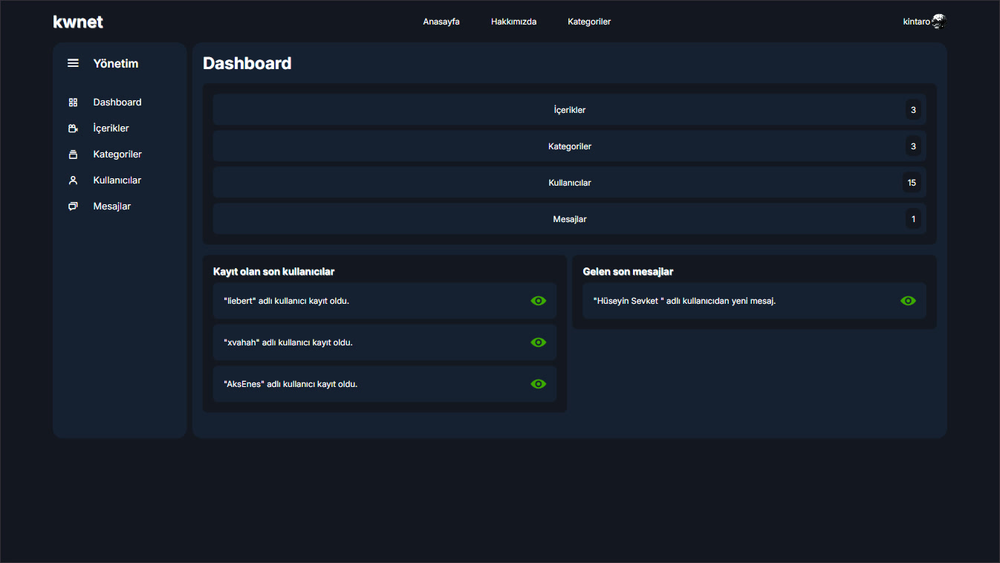

<a href="README.md">
  
</a>
<a href="README-TR.md">
  
</a>

  <br />
  <br />

<div align="center">
  
  <br />
  <br />

  <p>
    A comprehensive movie website for a school project
  </p>
 


  <p>
    <a href="#features">Features</a> •
    <a href="#tech">Technologies</a> •
    <a href="#installation">Installation</a> •
    <a href="#license">License</a> •
    <a href="#gallery">Gallery</a>
  </p>

  <br />
  <br />
</div>

## 📋 About

**kwnet** is a comprehensive movie-watching platform where movies are uploaded and published by the administrator, and users can discover, watch, leave comments, and add these movies to their favorites.

The project consists of two main sections: the user side and the administration panel. Users can register on the site to watch movies, leave comments, and add them to their favorites. Content management processes such as adding, editing, and deleting movies are performed **only by users with admin authority** via the admin panel.

## 🎓 School Project

This project was developed to put the knowledge gained in web programming and database management courses into practice. It aims to provide practical learning of fundamental web development topics such as server-side web development with ASP.NET Web Forms technology, relational database design with MySQL, user session management, CRUD operations, and file uploading.

Since it is an academic study, improvements can be made in some areas of the project (security, performance optimization, etc.). However, the project offers an integrated learning experience covering the end-to-end development of a web application, database design, user interface creation, and administration panel development.

## ✨ Features <a id="features"></a>

### 👤 User Management

- **Registration**: Multi-step registration form
- **Login**: Log in with username and password
- **Logout**: Secure logout with a confirmation dialog
- **Profile Viewing**: View own profile and other users' profiles
- **Profile Editing**: Update username, password, and profile picture

### 🎥 Movie Watching

- **Movie Detail Page**: Video player, cover image, description, view count, publisher information, comments
- **Movie Search**: Instant movie search feature on the homepage
- **View Counter**: Automatic view tracking for each movie
- **Show More**: Load more movies with pagination
- **Recommendation System**: Other movies in the side panel on the movie detail page

### 💬 Interaction System

- **Writing Comments**: Ability for logged-in users to write comments on movies
- **Editing Comments**: Edit own comments
- **Deleting Comments**: Delete comments with a confirmation dialog
- **Adding to Favorites**: Add and remove movies to/from favorites
- **My Favorites Page**: Personal page where favorite movies are listed

### 🗂️ Category System

- **Category Listing**: View all movie categories
- **Category Detail**: Filter movies belonging to the selected category
- **Category Management**: Add/delete/update categories from the admin panel

### 🛡️ Admin Panel

- **Dashboard**: Admin panel home page
- **Movie Management**: List all movies, view details, update title/description/category/image/video
- **Adding Movies**: 4-step movie addition wizard (title → category → description → cover image & video file)
- **User Management**: List all users and view details
- **Category Management**: List, add, edit, and delete movie categories
- **Message Management**: List, view details, and delete messages from the contact form
- **Role Control**: Access restricted to users with the "admin" role only

### 🎨 UI & Design

- **Custom CSS Framework**: A custom "kintaroCSS" library developed by myself
- **Responsive Design**: Flawlessly compatible interface for every device using media queries

## <a id="tech"></a>🛠️ Technologies

### Backend

- **ASP.NET 4.8**: Server-side web framework
- **C#**: Backend programming language
- **MySQL**: Relational database management system

### Frontend

- **HTML5**: Page structure and semantic markup
- **CSS3**: Style and visual design
- **JavaScript**: Client-side interactions

### Tools

- **IIS / IIS Express**: Web server
- **phpMyAdmin**: Database management
- **XAMPP**: Local development environment (Apache + MariaDB)
- **Visual Studio**: IDE (Development Environment)

## 🚀 Installation <a id="installation"></a>

### Requirements

- **Visual Studio**: [Visual Studio](https://visualstudio.microsoft.com/en-us/)
- **.NET Framework 4.8**: [.NET Framework 4.8](https://dotnet.microsoft.com/download/dotnet-framework/net48)
- **XAMPP**: [XAMPP](https://www.apachefriends.org/)
- **MySQL**: Comes bundled with XAMPP

### Step-by-Step Installation

1. **Clone the Repository:**

```bash
git clone https://github.com/xkintaro/asp.net-mysql-website.git
cd asp.net-mysql-website
```

2. **Create the Database**

- Start **XAMPP** and run the **Apache** and **MySQL** services.
- Navigate to `http://localhost/phpmyadmin` in your browser.
- Click the **"New"** button in the left panel to create a new database named `kwnet`.
- Select the database you created and click the **"Import"** tab.
- Import the `kwnet.sql` file located in the project directory.

3. **Configure Connection Settings**

Edit the connection string in the `site/Web.config` file according to your own environment:

```xml
<connectionStrings>
    <add name="MyDbConnection"
         connectionString="Server=localhost;Database=kwnet;User Id=root;Password=;"
         providerName="MySql.Data.MySqlClient" />
</connectionStrings>
```

> By default, the MySQL root user password for XAMPP is empty. If you have set a password, update the `Password=` field.

4. **Open the Project in Visual Studio**

- Open Visual Studio.
- Follow the path **"file → open → website"**.
- Select the `site/` folder.
- After opening the project, run it using **Ctrl + F5** or the **Run** button.

5. **Access the Application**

- Website: `http://localhost:{port}/Default.aspx`
- Admin Panel: `http://localhost:{port}/admin/`

### Default Admin Accounts

- Username: `admin` | Password: `12345678`
- Username: `kintaro` | Password: `12345678`

## 📄 License <a id="license"></a>

This project is licensed under the MIT License. See the [LICENSE](LICENSE) file for details.

## 🖼️ Gallery <a id="gallery"></a>


#


#


#



#


#


#


#

<p align="center">
  <sub>❤️ Developed by "Mustafa TAŞAL" (kintaro)</sub>
</p>