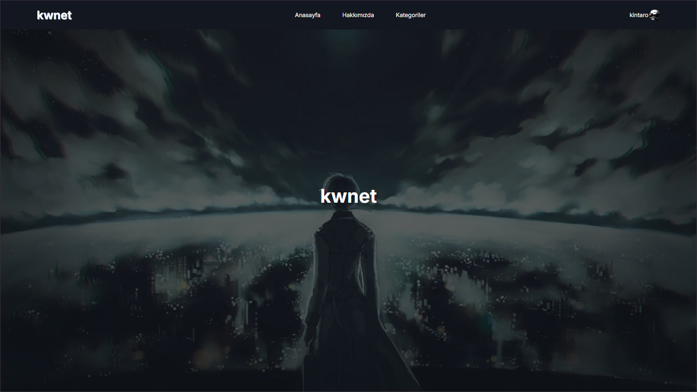
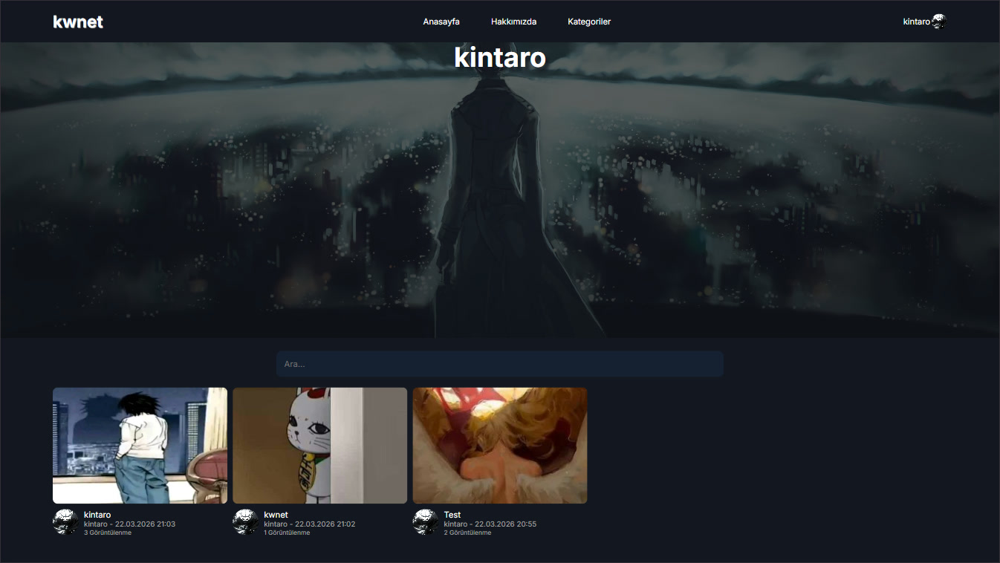
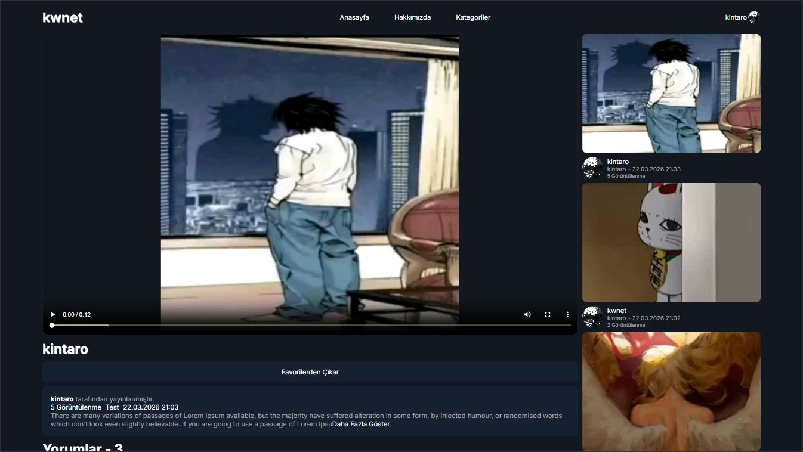
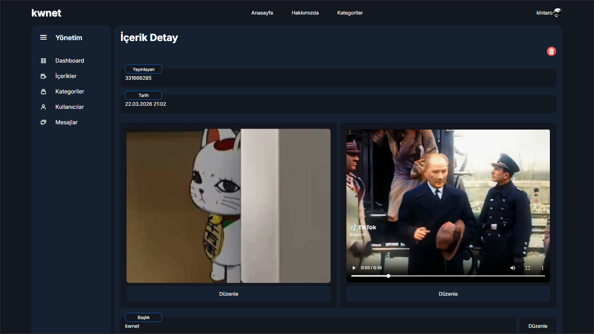
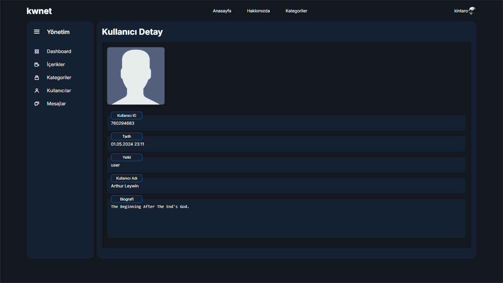

<a href="README.md">
  
</a>
<a href="README-TR.md">
  
</a>

  <br />
  <br />

<div align="center">
  
  <br />
  <br />

  <p>
     A movie website built with ASP.NET and MySQL for a school project.
  </p>


  <p>
    <a href="#info">Info</a> •
    <a href="#about">About</a> •
    <a href="#features">Features</a> •
    <a href="#tech">Tech</a> •
    <a href="#setup">Setup</a> •
    <a href="#gallery">Gallery</a> •
    <a href="#license">License</a>
  </p>

  <br />
  <br />
</div>

## <a id="info"></a> 📌 Info

The sample images and videos in the project belong to their respective owners. They are used only as sample content for this school project.

## <a id="about"></a> 📋 About

**kwnet** is a movie website I built as a school project to practice what I learned in web programming and database courses. Admins upload and publish the movies, and users can watch them, write comments and add them to their favorites. The project covers server-side development with ASP.NET Web Forms, database design with MySQL, session management, CRUD operations and file uploads. The interface is in Turkish.

## <a id="features"></a> ✨ Features

- **Registration and login**: Sign up with a step-by-step form and log in with your username and password.
- **Profiles**: View your own profile and other users' profiles, and change your username, password, profile photo and bio.
- **Movie pages**: Watch a movie in the video player and see its description, view count, publisher and comments.
- **Search**: Search movies by title on the home page.
- **Load more**: Show more movies and comments with a button.
- **Other movies**: The movie page lists other movies in the side panel.
- **Comments**: Write comments on movies, and edit or delete your own comments.
- **Favorites**: Add movies to your favorites and see them on your favorites page.
- **Categories**: Browse the categories and list the movies in a category.
- **Contact form**: Send a message from the about page.
- **Admin panel**: Admins can add movies in four steps, edit their title, category, description, cover and video, delete them, manage categories, see users and read or delete messages.

## <a id="tech"></a> 🛠️ Tech

`ASP.NET Web Forms` · `C#` · `.NET Framework 4.8` · `MySQL` · `MySql.Data` · `ImageResizer` · `HTML` · `CSS` · `JavaScript`

## <a id="setup"></a> 🚀 Setup

### Requirements

- **Visual Studio**: [https://visualstudio.microsoft.com/](https://visualstudio.microsoft.com/)
- **.NET Framework 4.8**: [https://dotnet.microsoft.com/download/dotnet-framework/net48](https://dotnet.microsoft.com/download/dotnet-framework/net48)
- **XAMPP** or another MySQL server: [https://www.apachefriends.org/](https://www.apachefriends.org/)

### Step-by-Step Installation

1. **Clone the repository**

   ```bash
   git clone https://github.com/xkintaro/asp.net-mysql-website.git
   cd asp.net-mysql-website
   ```

2. **Create the database**

   - Start **Apache** and **MySQL** from the XAMPP control panel.
   - Open [http://localhost/phpmyadmin](http://localhost/phpmyadmin) and create a new database named `kwnet`.
   - Select the database, open the **Import** tab and import the `kwnet.sql` file.

3. **Check the connection settings**

   Update the connection string in `site/Web.config` if your environment is different:

   ```xml
   <connectionStrings>
       <add name="MyDbConnection"
            connectionString="Server=localhost;Database=kwnet;User Id=root;Password=;"
            providerName="MySql.Data.MySqlClient" />
   </connectionStrings>
   ```

   The MySQL root user has no password in XAMPP by default.

4. **Open the project in Visual Studio**

   - Select **File → Open → Web Site** and choose the `site/` folder.
   - Run the project with **Ctrl + F5**.

Open the site at `http://localhost:{port}/Default.aspx` and the admin panel at `http://localhost:{port}/admin/`.

### Default Admins

- **Username**: `admin` · **Password**: `12345678`
- **Username**: `kintaro` · **Password**: `12345678`

## <a id="gallery"></a> 🖼️ Gallery













## <a id="license"></a> 📄 License

This project is licensed under the MIT License. See the [LICENSE](LICENSE) file for details.

#

<p align="center">
  <sub>❤️ Developed by "Mustafa TAŞAL" (kintaro)</sub>
</p>
