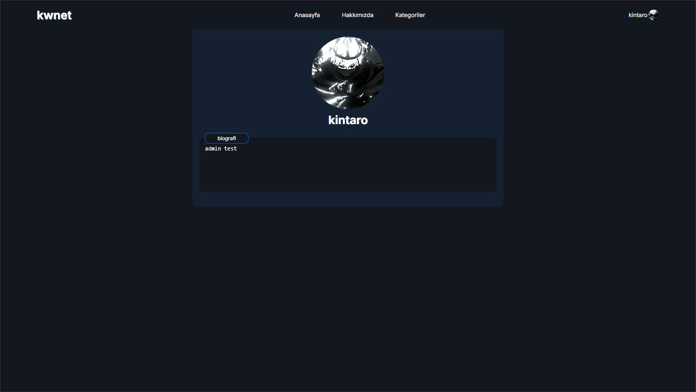

## 📋 About

**TR - TÜRKÇE**

Bu web sitesini lisedeyken, okulda öğrendiklerimle geliştirmiştim. Yaptığım ilk gerçekten tatmin edici projelerden biriydi. Birçok işlevi ve mantığı nasıl kuracağımı bu proje sayesinde öğrendim; tablolar arası ilişkiler, kullanıcı ve admin giriş sistemleri gibi. O zamanlar yapay zekâ da yoktu, bu yüzden neyi nasıl yapacağımı tam olarak bilmeden, düşünerek ve deneme yanılmayla ilerlemek gerçekten keyifliydi. Bu projeyi bir anı ve arşiv olarak burada saklıyorum.

##

**EN - ENGLISH**

I built this website back in high school using what I learned at school. It was my first project that actually felt good. I learned how to build most of the logic and features here—things like relationships between tables, user authentication, admin panels, etc. Back then, there was no AI, so figuring things out on my own and writing code without knowing exactly how to do it was actually really enjoyable. I'm keeping this here as a memory and an archive.

##

##

##

##

##

##

